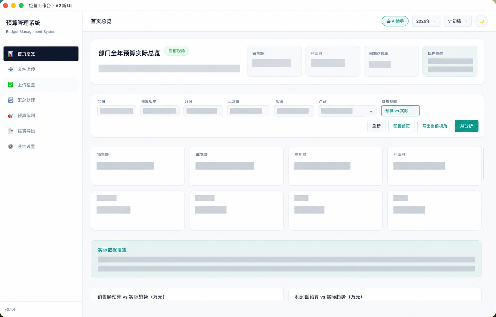

# 经营工作台

一个在本机运行的预算与实际经营分析工具。支持导入 Excel 预算、销售和费用数据，检查表格格式及计算结果，查看预算与实际对比，导出 Excel 报表和离线看板。

桌面端使用 Electron，界面使用 React 和 Vite，后端使用 FastAPI 和 SQLite。桌面菜单「经营工作台 → 界面样式」可在经典版 V1 和新版 V2 之间切换。



## 下载与安装

从 [GitHub Releases](https://github.com/liyuliang1004-gif/budget-workbench-open-source/releases/latest) 下载适合你电脑的桌面安装包。升级前请完全退出旧版，覆盖安装后继续使用原来的数据保存目录。

### macOS（Apple 芯片）

1. 下载名称以 `mac-arm64.dmg` 结尾的文件，打开后把「经营工作台」拖到「应用程序」。
2. 在「应用程序」打开经营工作台。如果系统提示无法验证开发者或无法检查 App，请先校验安装包。确认来源和哈希后，到「系统设置 → 隐私与安全性」选择「仍要打开」。[Apple 官方说明](https://support.apple.com/zh-cn/102445)

如果 DMG 无法挂载，或 macOS 提示 App 已损坏，先检查下载文件。下面以 **0.1.4** 下载到「下载」文件夹为例。其他版本请替换文件名和对应的 SHA-256。

```bash
shasum -a 256 "$HOME/Downloads/BusinessWorkbench-0.1.4-mac-arm64.dmg"
hdiutil verify "$HOME/Downloads/BusinessWorkbench-0.1.4-mac-arm64.dmg"
```

0.1.4 的 Mac DMG SHA-256 为 `20135f155dd292e02fa5cee00348ed6accaa1927bb2a16d7aaf07a278a60c749`。如果哈希不一致或镜像校验失败，请从发布页重新下载。如果镜像校验通过，请先从该镜像重新把 App 复制到「应用程序」再试。

这个版本未经过 Apple 公证。如果校验通过、重新复制后仍是首次打开的隔离拦截，并且你确认信任该包，可在「终端」仅移除「经营工作台」的下载隔离标记，再打开它：

```bash
xattr -dr com.apple.quarantine "/Applications/经营工作台.app"
open "/Applications/经营工作台.app"
```

如果系统明确提示检测到恶意软件或 App 将损坏你的电脑，请停止安装。受单位管理的电脑请联系管理员。

### Windows（64 位）

下载名称以 `windows-x64.exe` 结尾的文件，双击并按安装向导操作。首次打开可能出现 SmartScreen 的未知发布者提示。先核对 SHA-256，确认可信后，在提示窗口有「更多信息 → 仍要运行」选项时，可以继续安装。如果检测到威胁或遇到管理员策略拦截，请停止安装。[Microsoft 官方说明](https://support.microsoft.com/zh-cn/windows/security/windows-security/protection-history-in-the-windows-security-app)

如果安装程序打不开或提示文件不完整，可用 PowerShell 检查。下面以 **0.1.4** 下载到「下载」文件夹为例：

```powershell
Get-FileHash -Algorithm SHA256 -LiteralPath "$env:USERPROFILE\Downloads\BusinessWorkbench-0.1.4-windows-x64.exe"
```

0.1.4 的 Windows 安装包 SHA-256 为 `97cdbcfc305f45f56d9410494d72789608c698cb89665445b130ffc4b6b9ee3d`。如果哈希不一致，请从发布页重新下载。

## 从源码运行

准备 Git、Node.js 22.12 或以上版本，以及 Python 3.13 或 3.14。

```bash
git clone https://github.com/liyuliang1004-gif/budget-workbench-open-source.git
cd budget-workbench-open-source
python3 -m venv .venv
source .venv/bin/activate
python -m pip install -r requirements.txt
npm ci
npm run desktop
```

Windows PowerShell 下可用 `py -3.13 -m venv .venv` 创建环境，再运行 `.\.venv\Scripts\Activate.ps1`。其余安装和启动命令相同。

首次在桌面端启动时，选择一个独立目录保存 SQLite 数据库、配置、上传文件和导出结果。可以在「文件上传」下载空白预算模板和带示例行的实际经营模板。

也可以用浏览器打开工作台。先运行 `npm run build:v2`，再用虚拟环境运行 `python -m uvicorn backend.main:app --host 127.0.0.1 --port 8000`。访问 [经典版 V1](http://127.0.0.1:8000/index.html) 或 [新版 V2](http://127.0.0.1:8000/index_v2.html)。浏览器启动方式默认使用仓库下的 `data/`，也可通过 `BUDGET_WORKBENCH_DATA_DIR` 指定目录。

AI 分析是可选功能，可在「系统设置」配置自己的 DeepSeek 凭据和服务地址。启用后，AI 分析请求会把用于分析的经营数据发送给所配置的服务。

## 本机只读 API 与 MCP

软件运行期间，从菜单「经营工作台 → 只读数据接口」复制当前地址。REST 入口为 `/api/read-only`，MCP 入口为 `/mcp`，采用 Streamable HTTP。可查询经营汇总、预算销售与费用、实际销售与费用。接口仅供同一台电脑的软件访问。

参阅 [只读接口对接说明](docs/给其他软件Codex的只读接口对接指令.md)。

## 测试与打包

```bash
python -m pytest backend/tests -q
npm run desktop:test
npm run build:v2
```

在对应平台执行 `npm run desktop:dmg`（macOS）或 `npm run desktop:win`（Windows，需先激活 Python 虚拟环境）。公开仓库中的 Windows 工作流也可手动触发，构建结果可在对应运行记录中下载。

## 许可证

项目源码使用 [MIT 许可证](LICENSE)。
